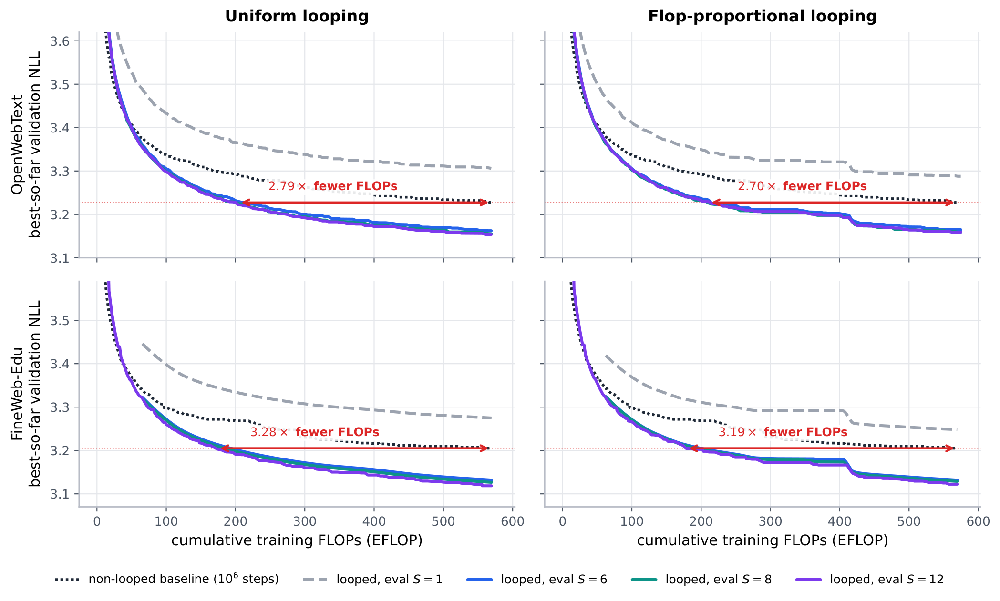

# Looped Uniform Diffusion Language Models

Code for **Looped Uniform Diffusion Language Models** (looped-UDLM). A small
DUO++ uniform-state diffusion transformer shares the weights of blocks 1–2 and
replays them $`S`$ times per denoiser call. Parameters stay fixed while executed
depth grows. We train it with stochastic loop counts under an iso-FLOP budget.
At test time you pick a fixed depth, or let every sample stop on its own once
its hidden state converges.

<p align="center">
  
</p>

**Looping is training-compute efficient on both pretraining corpora.** The
figure plots best-so-far validation NLL against training FLOPs for the uniform
(left) and flop-proportional (right) schedules, on OpenWebText (top) and
FineWeb-Edu (bottom). The looped models reach the non-looped baseline's best
NLL with **2.79× / 2.70× fewer FLOPs on OpenWebText** and **3.28× / 3.19× fewer
on FineWeb-Edu**. Every evaluation depth $`S \geq 6`$ lies on one shared frontier.

What's in the repository:

- **Looped DiT** (`models/dit.py`): the head runs once, the looped slice runs $`S`$ times with shared parameters, then the tail runs once.
- **Training schedules** (`loop_schedule.py`): `uniform`, `flop_proportional`, and `noise_proportional` loop counts.
- **FLOP accounting** (`flops.py`): per-step cost and the iso-FLOP step budgets.
- **Test-time evaluation**: fixed-depth sweeps and per-sample adaptive looping, for validation likelihood, generation, zero-shot likelihood, and multiple choice.
- **Telemetry**: training logs the loop count and cumulative training FLOPs; evaluation logs likelihood at every depth, plus realized depth and compute savings under adaptive looping.

## Setup

```bash
conda create -n looped_udlm python=3.12 -y && conda activate looped_udlm
pip install -r requirements.txt
pip install flash_attn==2.7.4.post1 --no-build-isolation   # optional, GPU only

cp .env.example .env    # then fill in WANDB_API_KEY, WANDB_ENTITY, HF_TOKEN
```

Every script loads `.env`, which sets:

| Variable | Purpose |
|---|---|
| `WANDB_API_KEY`, `WANDB_ENTITY`, `WANDB_PROJECT` | W&B logging (project defaults to `looped_udlm`) |
| `WANDB_MODE` | `online`, `offline` (log locally, sync later), or `disabled` |
| `HF_TOKEN` | Hugging Face access while the data and checkpoint repos are private |
| `LOOPED_UDLM_DATA`, `OUTPUT_ROOT` | data and run directories (defaults `./data`, `./outputs`) |
| `CUDA_VISIBLE_DEVICES` | GPUs to use (default: all visible) |

## Data: download and train

The two pretraining corpora are published **already tokenized with GPT-2 and
packed into 1024-token blocks**, in the format the dataloader reads directly.
There is no tokenization or packing step: download them and train.

| Corpus | Hugging Face dataset | Validation split |
|---|---|---|
| OpenWebText | [`saitejautpala/openwebtext-gpt2-packed-1024`](https://huggingface.co/datasets/saitejautpala/openwebtext-gpt2-packed-1024) | DUO's OWT split |
| FineWeb-Edu (sample-10BT) | [`saitejautpala/fineweb-edu-10bt-gpt2-packed-1024`](https://huggingface.co/datasets/saitejautpala/fineweb-edu-10bt-gpt2-packed-1024) | last 100k documents |

Each block is `[BOS] + 1022 tokens + [EOS]`, and documents are separated by EOS.

```bash
bash scripts/download_data.sh owt            # -> data/openwebtext
bash scripts/download_data.sh fineweb-edu    # -> data/fineweb-edu
```

## Training

```bash
bash scripts/train.sh owt baseline               # 1,000,000 steps, S = 1
bash scripts/train.sh owt uniform                # 655,420 steps
bash scripts/train.sh owt flop_proportional      # 688,915 steps
bash scripts/train.sh owt noise_proportional     # 655,420 steps
bash scripts/train.sh fineweb-edu uniform        # same schedules on FineWeb-Edu
```

These are the paper's 4×H100 settings. The global batch is 512 sequences of
length 1024. The baseline uses a per-GPU micro-batch of 32 (4 accumulation
steps); looped runs use 16 (8 accumulation steps) to fit the deeper unrolls.
Training uses the DUO++ poly9 curriculum over the first 500k steps, validates
every 10k steps, and checkpoints every 50k steps plus the exact final step.

Each looped run stops at the step budget whose training FLOPs match 1M
baseline steps; `train.sh` computes the budget from `flops.py`. Re-running the
same command resumes from `outputs/<data>/<schedule>_seed<seed>/checkpoints/last.ckpt`.
Any GPU count works as long as it divides the global batch. Use
`SEED`, `BATCH_SIZE`, and `GLOBAL_BATCH` to change those settings. Extra
arguments pass through as Hydra overrides, for example
`bash scripts/train.sh owt uniform trainer.max_steps=1000`.

### Loop schedules

| `model.loop.schedule` | Loop count per forward pass | Mean $`S`$ |
|---|---|---|
| `uniform` | one $`S \sim \mathcal{U}\{1,\dots,12\}`$ per optimizer step, shared by all GPUs | 6.5 |
| `flop_proportional` | one $`S \sim p(S) \propto F(S)^{-\beta}`$ per step, with $`\beta = 1`$ (`flop_power`) | 5.72 |
| `noise_proportional` | micro-batches own contiguous noise bands; band $`b`$ draws $`S`$ from the $`b`$-th depth sub-range | 6.5 |

Here $`F(S)`$ is the forward FLOPs of one sequence at depth $`S`$. With
$`\beta = 1`$, every depth receives the same share of training FLOPs. The noise
bands number $`B = \gcd(\text{GPUs} \times \text{accumulation}, 12)`$, so the
marginal over $`S`$ is exactly uniform. Draws are seeded by `(seed, step)`,
so all ranks agree without communication and resumed runs repeat the same
schedule.

The other loop settings live in `configs/model/small.yaml`: `start: 1`,
`num_layers: 2`, `train_min`/`train_max`, `eval_count`, `eval_policy`,
`adaptive_epsilon`, and `eval_count_sweep`.

### Training telemetry (W&B)

| Metric | Meaning |
|---|---|
| `trainer/loop_count` | loop count used in the step |
| `trainer/train_flops` | cumulative training FLOPs, summed over GPUs (saved in checkpoints) |
| `val/nll`, `val/ppl` | validation likelihood at `eval_count` |
| `val/nll@S`, `val/ppl@S` | validation likelihood at each depth in `eval_count_sweep` (default `[1,6,8,12]`), on paired noise |

## Checkpoints

The three final OpenWebText checkpoints are on
[`saitejautpala/looped_udlm`](https://huggingface.co/saitejautpala/looped_udlm):
the baseline at 1M steps, uniform at 655,420 steps, and flop-proportional at
688,915 steps. Their training logs are in the W&B project
[`saitejautpala/looped_udlm`](https://wandb.ai/saitejautpala/looped_udlm).

```bash
bash scripts/download_checkpoints.sh      # -> checkpoints/owt/*.ckpt
```

## Test-time evaluation

Each evaluation script takes a checkpoint and a depth policy:

- `baseline` for the non-looped checkpoint;
- an integer `S` for a looped checkpoint at a fixed depth, including depths beyond training such as 24;
- `adaptive` for per-sample adaptive looping.

Under adaptive looping, let $`h_i^{(s)}`$ be the hidden state of sequence $`i`$
after the $`s`$-th traversal of the looped slice. The sequence stops at

```math
S_i = \min\left\{ s \,:\, \frac{\lVert h_i^{(s)} - h_i^{(s-1)} \rVert_F}{\lVert h_i^{(s)} \rVert_F} < \epsilon \right\},
```

with $`\epsilon = 0.1`$ (`EPSILON`) and a cap of $`S_{\max} = 12`$ (`S_MAX`).
Converged sequences are removed from the recurrent batch. So each sequence
executes exactly $`S_i`$ traversals, and the reported compute counts only the
traversals actually run.

```bash
# Validation likelihood (NELBO perplexity bound); DATA=fineweb-edu for FineWeb-Edu
bash scripts/eval_ppl.sh checkpoints/owt/uniform_step655420.ckpt 12
bash scripts/eval_ppl.sh checkpoints/owt/uniform_step655420.ckpt adaptive

# Generation: Gen. PPL under GPT-2 Large + entropy, 512 samples, nucleus p = 0.9
STEPS=256 bash scripts/gen_ppl.sh checkpoints/owt/flop_proportional_step688915.ckpt adaptive
PREDICTOR=psi bash scripts/gen_ppl.sh checkpoints/owt/baseline_step1000000.ckpt baseline

# Zero-shot likelihood on PTB, WikiText-103, LM1B, LAMBADA, AG News, PubMed, arXiv
bash scripts/zero_shot.sh checkpoints/owt/uniform_step655420.ckpt 8

# Zero-shot multiple choice (pip install lm-eval)
bash scripts/mcq.sh checkpoints/owt/uniform_step655420.ckpt adaptive
```

Results go to `outputs/{eval,samples,zero_shot,mcq}/`. Adaptive runs also
record depth telemetry: `mean_depth`, a `depth_histogram`,
`converged_fraction`, `compaction_saving` (work avoided by removing converged
sequences), and `saving_vs_max` (relative to always running $`S_{\max}`$).
Validation logs the same values as `val/loop_*`.

## Tests

The tests run on CPU in under a minute, using a 6-block toy DiT.

```bash
pytest tests
```

- `test_loop_schedule.py` covers the schedule distributions, equal FLOPs per depth under `flop_proportional`, the uniform marginal and band coupling of `noise_proportional`, determinism, and the iso-FLOP budgets (655,420 and 688,915).
- `test_looped_dit.py` checks that $`S = 1`$ equals the plain stack and that looping equals an explicitly unrolled, untied stack with the same parameter count. For adaptive looping it covers stopping at the bounds, per-sample stopping with compaction (each sequence matches running it alone at its realized depth), and that it is off during training.
- `test_training.py` runs Lightning training for each schedule. It checks one shared depth per optimizer step, noise bands mapped to accumulation steps, FLOP telemetry with its checkpoint round-trip, and the non-looped baseline.
- `test_test_time_eval.py` covers eval-depth resolution, the validation depth sweep, adaptive validation and generation telemetry, and loading the released checkpoints.

## Repository layout

```
models/dit.py        looped DiT, fixed and per-sample adaptive looping
loop_schedule.py     uniform / flop_proportional / noise_proportional schedules
flops.py             FLOP accounting and iso-FLOP step budgets
trainer_base.py      loop-count resolution, telemetry, depth sweep (+ DUO trainer)
algo.py, main.py     DUO / DUO++ objectives and the Hydra entry point
configs/             Hydra configs (packed OWT / FineWeb-Edu, 4xH100 defaults)
scripts/             download, train, and evaluation entry points (load .env)
tests/               CPU test suite
```

## Acknowledgements

This code builds on [DUO](https://github.com/s-sahoo/duo).
